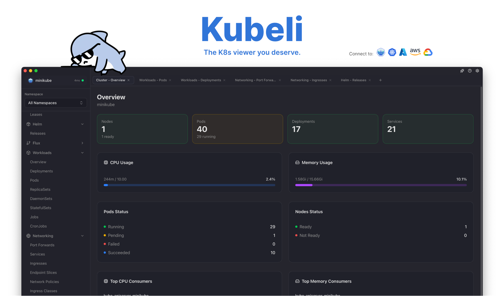

<p align="center">
  
</p>

<p align="center">
  <a href="https://github.com/atilladeniz/Kubeli/actions/workflows/ci.yml"></a>
  <a href="https://github.com/atilladeniz/Kubeli/releases/latest"></a>
  <a href="https://github.com/atilladeniz/Kubeli/blob/main/LICENSE"></a>
  <a href="https://cyclonedx.org/"></a>
  
  <a href="https://github.com/atilladeniz/Kubeli/releases"></a>
  <a href="https://deepwiki.com/atilladeniz/Kubeli"></a>
</p>

# Kubeli

A modern, beautiful Kubernetes management desktop application with real-time monitoring, terminal access, and a polished user experience.

<p align="center">
  <a href="https://github.com/atilladeniz/Kubeli/releases/latest">
    
  </a>
  &nbsp;&nbsp;
  <a href="https://github.com/atilladeniz/Kubeli/releases/latest">
    
  </a>
  &nbsp;&nbsp;
  <a href="https://github.com/atilladeniz/Kubeli/releases/latest">
    
  </a>
</p>

<p align="center">
  
  
  
  
</p>

## Features

- **Multi-Cluster Support** - Connect to multiple clusters, auto-detect provider type (Minikube, EKS, GKE, AKS)
- **Real-Time Updates** - WebSocket-based pod watching with efficient Kubernetes watch API
- **Resource Browser** - View and manage Pods, Deployments, Services, ConfigMaps, Secrets, Nodes, and more
- **Pod Logs** - Stream logs in real-time with filtering, search, and export
- **Terminal Access** - Interactive shell access to running containers via XTerm.js
- **Port Forwarding** - Forward ports from pods/services to localhost with status tracking
- **Metrics Dashboard** - CPU and memory usage visualization (requires metrics-server)
- **YAML Editor** - Full Monaco editor integration for viewing and editing resources
- **AI Assistant** - Integrated AI support with Claude Code CLI and OpenAI Codex CLI
- **MCP Server** - Model Context Protocol server for IDE integration (VS Code, Cursor, Claude Code)
- **Helm Releases** - View and manage Helm deployments
- **Proxy Support** - HTTP/HTTPS/SOCKS5 proxy configuration for corporate environments
- **Internationalization** - English, German and Simplified Chinese UI ([see languages](#languages))
- **Dark/Light Mode** - Theme support with vibrancy effects

## Languages

| Language | Native name | Code | Translated |
|----------|-------------|------|------------|
| English | English | `en` |  |
| German | Deutsch | `de` |  |
| Simplified Chinese | 简体中文 | `zh` |  |

Coverage counts translated keys against `src/i18n/messages/en.json`. A test fails if a catalog is missing a key. Kubernetes kinds (Pod, Deployment, ConfigMap, ...), acronyms and product names stay in English on purpose.

The app follows your system language by default. You can switch it in **Settings → Appearance → Language**.

Want to add a language? Copy `en.json` to `<code>.json`, translate the values, and register the code in `src/i18n/config.ts` and `src/i18n/getMessages.ts`.

## Tech Stack

| Layer | Technology |
|-------|------------|
| Frontend | Vite, React 19, TypeScript, Tailwind CSS 4 |
| Desktop | Tauri 2.9 (Rust) |
| K8s Client | kube-rs with k8s-openapi v1.35 |
| State | Zustand |
| UI Components | Radix UI, Lucide Icons |
| Editor | Monaco Editor |
| Terminal | XTerm.js |
| Charts | uPlot |

## Installation

### Build from Source

**Prerequisites:**
- Node.js 18+
- Rust 1.70+
- npm (default) or pnpm

```bash
# Clone the repository
git clone https://github.com/atilladeniz/kubeli.git
cd kubeli

# Install dependencies
make install

# Run in development mode
make dev

# Build for production (macOS)
make build

# Build for Windows (cross-compile from macOS)
make install-windows-build-deps  # One-time setup
make build-windows

# Build both platforms
make build-all
```

## Development

```bash
# Start Tauri + Vite dev environment
make dev

# Start Vite only (no Tauri)
make web-dev

# Run linting
make lint

# Format code
make format

# Type check
make check
```

More commands, tests, screenshot automation, the local testing lab, vet and the project layout are in [docs/development.md](docs/development.md).

## Security

Every release ships CycloneDX SBOMs, and CI scans the code with Trivy and Semgrep. See [docs/security.md](docs/security.md).

## Platform Support

### macOS
- **Requirements:** macOS 10.15+ (Catalina or later)
- **Architecture:** Apple Silicon (arm64) native
- **Auto-Updates:** Fully supported via Tauri updater

### Windows
- **Requirements:** Windows 10/11 (64-bit)
- **WebView2:** Automatically installed if missing (embedded bootstrapper)
- **Auto-Updates:** Fully supported via Tauri updater
- **Note:** First launch may show SmartScreen warning (app is not code-signed with Microsoft certificate)

### Linux
- **Requirements:** x64 Linux with GLIBC 2.31+ (Ubuntu 20.04+, Fedora 33+, etc.)
- **Format:** AppImage (portable, no installation required)
- **Auto-Updates:** Fully supported via Tauri updater

### Windows Development Setup

For developing or testing Kubeli on Windows, see the [Windows Setup Guide](.dev/windows/WINDOWS-SETUP.md).

## Supported Kubernetes Providers

| Provider | Detection | Icon |
|----------|-----------|------|
| Minikube | Context name | Yes |
| AWS EKS | Context/URL pattern | Yes |
| Google GKE | Context/URL pattern | Yes |
| Azure AKS | Context/URL pattern | Yes |
| Generic K8s | Fallback | Yes |

## Contributing

We welcome contributions! Please read our [Contributing Guide](CONTRIBUTING.md) and [AI Usage Policy](AI_POLICY.md) before submitting PRs.

## Changelog

See [CHANGELOG.md](CHANGELOG.md) for a detailed list of changes.

## Contributors

Thanks to everyone who has contributed to Kubeli. If you want to help, start with the [Contributing Guide](CONTRIBUTING.md).

<a href="https://github.com/atilladeniz/Kubeli/graphs/contributors"></a>

## Star History

<a href="https://www.star-history.com/#atilladeniz/Kubeli&Date">
  <picture>
    <source media="(prefers-color-scheme: dark)" srcset="https://api.star-history.com/svg?repos=atilladeniz/Kubeli&type=Date&theme=dark" />
    <source media="(prefers-color-scheme: light)" srcset="https://api.star-history.com/svg?repos=atilladeniz/Kubeli&type=Date" />
    
  </picture>
</a>

## License

This project is licensed under the MIT License - see the [LICENSE](LICENSE) file for details.

## Code signing

Free code signing on Windows provided by [SignPath.io](https://about.signpath.io), certificate by [SignPath Foundation](https://signpath.org). See the [Code Signing Policy](https://kubeli.dev/code-signing-policy) for roles, what gets signed, and how to verify a download.

## Author

Created by [Atilla Deniz](https://atilladeniz.com)
